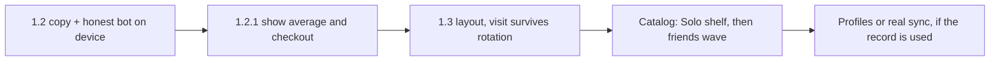

# Solo companion

**Status:** Draft  
**Created:** 2026-10-27  
**Goal:** Dart Buddy is the companion that records the games and lets you play in a lot of ways, alone or with friends. No ads. No account. The record stays on the phone.

**Does not change 1.2 scope.** 1.2 stays 10 modes, Training Partner, German, export. Layout stays the proposed 1.3 in [`duo-dynamic-layout-release-plan.md`](../docs/plans/duo-dynamic-layout-release-plan.md). This plan is the product thread those releases serve.

**Reference:** [My Dart Training](https://apps.apple.com/us/app/my-dart-training/id1529123323). Android is where that app won (about 21k reviews). The US App Store listing has 22 ratings. Its subtitle is the outcome (“improve your skills”). Its complaints are ads, a rubber-band CPU, a bot whose checkout rate is hidden, practice games the bot cannot join, and a backup that is not a shared record across iPhone and iPad.

**Last updated:** 2026-10-27

---

## What we take

| Their lesson | Dart Buddy |
|--------------|------------|
| Lead with the record and playing alone. Friends are the second sentence. | 1.2 store copy. Modes stay in the list, not the headline. |
| A bot should hold an average. Show that average and the checkout rate. | Training Partner already targets about 4% above the player. 1.2 proves it on device. The next slice shows the numbers. |
| Each drill needs a short explanation. | Bob’s 27, Halve-It, and Around the Clock already have rules pages. 1.2 only has to make sure they are one tap away. |
| Practice and friends are different shelves. | Modes catalog, whenever it ships. Two sections: Solo, With friends. |
| People compare setups (different darts, different rooms). | Later. Not a 1.2 or 1.3 feature. |
| The record has to survive a second device. | Export stays a file until a real sync exists. Do not call DBPE sync. |

## What we leave there

- Ads, and a second App Store listing to remove them.
- Fifteen difficulty levels that do not hold an average.
- A drill list long enough to match theirs (JDC, A1, Catch 40, Game 121, checkout trainer). Bob’s 27 and Halve-It are already the practice pack.
- A named caller. Turn-total speech already ships. A full “180” caller stays in [`FutureIdeas/talk-mode.md`](../FutureIdeas/talk-mode.md).
- An Android catalog race. Their home ground is Play Store. This thread is iPhone.

---

## 1.2 — say it, and prove the bot

No new modes. No new screens beyond what the training-partner checklist already requires.

### Store copy

Replace the draft subtitle `Training Partner & Deutsch` in [`1.2.0-app-store-copy.md`](../docs/release/1.2.0-app-store-copy.md) before the Connect paste.

| Field | Use |
|-------|-----|
| Subtitle | `Solo practice. No ads.` (22) |
| German subtitle | `Allein üben. Keine Werbung.` (26) |

Opening paragraph, then the mode list:

> Dart Buddy records the game and lets you throw alone or with friends. Training Partner is a bot set just above your average, after five finished games. Solo drills, party games, and X01 stay on your iPhone. No ads. No account.

German listing follows the same order: record, alone or with friends, bot, no ads. Deutsch is a screenshot and a What’s New line, not the subtitle.

What’s New keeps the feature bullets already drafted. Screenshots: one solo drill, one friends game, history, Training Partner. Not a grid of ten names.

Export copy says it writes a backup file. It does not say the record follows you to another device.

### Device gate (already in the training plan)

On a real board session, X01 against Training Partner:

- The bot’s scoring stays near the snapshotted average (about 4% above the player, clamped as in [`TrainingBotSpec.md`](../specs/TrainingBotSpec.md)).
- Checkouts do not collapse into 0–40 visits after a hot scoring phase, and they do not finish like a pro on a beginner’s history.
- The match screen states which modes the partner plays: X01 and Cricket. Practice drills stay human-only until a later decision.

Rules: from a Bob’s 27, Halve-It, and Around the Clock match, the existing guide opens. Pages already live in `GameRulesCatalog`.

---

## 1.2.1 — show the numbers

Small release after 1.2 is submitted. Do not pull it into the 1.2 RC.

- At match start, show the Training Partner snapshot: target average (X01) or MPR (Cricket).
- On the summary, show average and checkout rate for the human and the bot, from the same darts the match already stored.
- The bot row is labeled as a bot. A zero-game bot does not get averaged into the human’s stats (the 1.2 P1 fix stays).
- When Android grows past lean 1.0, these two numbers ship with Training Partner. They do not land on iOS first and wait.

Out of this slice: new drills, Modes tab, cloud.

---

## 1.3 — the phone at the board

Layout release stays [`duo-dynamic-layout-release-plan.md`](../docs/plans/duo-dynamic-layout-release-plan.md). Add one acceptance to that ship bar:

- Rotating, or resizing to a phone-width window, does not drop the in-progress visit.
- Score targets stay thumb-sized. A phone-width iPad split does not keep tablet pad widths.

No new modes in 1.3. No Duo badge on the store.

---

## Next catalog release — two shelves

This rides with the Modes catalog, currently after the layout release. It is not a new engine project.

| Shelf | What becomes reachable |
|-------|------------------------|
| **Solo** | Around the Clock (already in 1.1), Bob’s 27, Halve-It, plus the practice engines already built: 180 Around the Clock, Chase the Dragon, Nine Lives. Each opens its existing rules page. |
| **With friends** | The 1.2 set stays. Further party modes ungated only after Solo is in and device-checked. One wave, not the whole catalog. |

Coming-soon rows stay visible and not tappable. Training Partner stays on X01 and Cricket until a drill has a real skill profile. Bob’s 27 must not fall through to the easy-bot fallback and get called a Training Partner.

Play home can offer one solo shortcut and one “with friends” shortcut. The Modes tab is the shelf. Player-detail practice shortcuts stay deferred ([`SoloPracticeModesSpec.md`](../specs/SoloPracticeModesSpec.md)).

---

## Later, only if the record is getting used

Do not start these in parallel with 1.2 or 1.3.

| Idea | Why it waits |
|------|----------------|
| **Setup profiles** | Separate histories for different darts or rooms. Their users ask for this by name. It is a new record model, not a label on the player. |
| **The record on a second device** | iPhone + iPad is the complaint. DBPE export is the honest answer until sync is designed. No Auth, no “cloud” sentence in the listing before that. |
| **Bot inside a practice drill** | Only after that drill has a skill profile. A rubber-band bot in Bob’s 27 repeats their mistake. |
| **More drills** | Checkout trainer, target training, JDC, A1. Ask after the Solo shelf has been out. |

---

## Order

